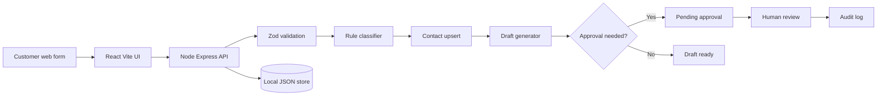

# Architecture
## MVP diagram

## Production reference
React/TypeScript -> API gateway -> Node/TypeScript -> PostgreSQL/Prisma; Redis/BullMQ for asynchronous processing; LLM adapter for classification/drafting; provider adapters for email, WhatsApp and CRM; auth with RBAC; OpenTelemetry logs and metrics.
## Boundaries
UI never holds provider secrets. API validates all payloads. Workflow engine owns transitions. CRM adapter owns deduplication and external IDs. Delivery adapter sends only after policy checks and explicit authorization.
## Important MVP limitations
JSON file storage is single-process only; no concurrency guarantees or migrations. Authentication, rate limiting, retries and outbound integration are not implemented. Do not deploy publicly as-is.
